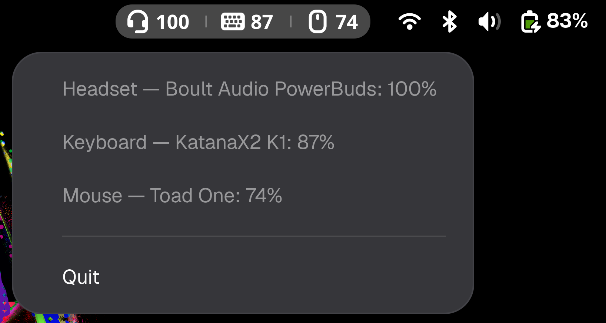

# bt-battery-alert

Low-battery notifications and tray icons for Bluetooth devices on Linux.

- One wide tray icon for all your Bluetooth devices, side by side: the
  Adwaita icon for each device type (mouse, keyboard, headset, headphones,
  speakers, game controller, phone, or the Bluetooth symbol for anything
  else) followed by its charge number in the top bar's font. A device's icon
  and number are white when healthy, orange at or below the alert threshold, red
  at or below the critical level (half the threshold), and blue while
  charging, in soft GNOME palette tones. Click the icon to see every
  device's level, plus a Quit item.
- A desktop notification in the style of the system's low-battery warning
  ("Mouse battery low — Toad One is low on power (34%)") when a device reaches
  40%, and a second, critical one at 20%. A notification is replaced in place
  rather than stacked, and is withdrawn when the device charges. A device has
  to recover to threshold + 5% or start charging before it can alert again.

Most Bluetooth devices report only a percentage, never a charging state
(UPower shows `state: unknown`). For those, charging is inferred: a rise of 3
points from the lowest reading counts as charging, and a drop of 3 from the
highest counts as unplugged. The first reading after start-up has no history,
so a device plugged in at a low level can still alert once before the rise
is seen.

Battery levels come from UPower over D-Bus, so the tool covers every device
BlueZ reports a battery for. The tray uses the StatusNotifierItem protocol
directly: no libappindicator needed.

## Requirements

Python 3 with `python3-gobject`, `python3-dbus` and `python3-cairo`, plus
`upower`, `bluez`, `librsvg2`, `pango` and `adwaita-icon-theme`. Fedora ships all of these in a standard Workstation
install.

**GNOME** has no tray of its own. Install and enable the AppIndicator
extension to see the icons (notifications work without it):

    sudo dnf install gnome-shell-extension-appindicator
    # log out and back in, then:
    gnome-extensions enable appindicatorsupport@rgcjonas.gmail.com

KDE Plasma, XFCE, Cinnamon, Budgie and waybar/swaybar tray hosts work
out of the box. The icon is handed to the tray as a wide SVG file (in
`$XDG_RUNTIME_DIR/bt-battery-alert/`), which GNOME's AppIndicator extension
shows at full width and draws sharp at any display scale; trays that force
icons to a square shrink it to fit.

## Use

    ./bt-battery-alert --list          # print levels and exit
    ./bt-battery-alert                 # run in the foreground
    ./install.sh                       # install to ~/.local and start at login
    ./uninstall.sh

Options:

    -t, --threshold N    alert at or below N% (default 40)
    -c, --critical N     second, critical alert at or below N% (default half of -t)
    -i, --interval S     full re-read every S seconds, besides UPower signals (default 60)
    --no-tray            notifications only
    --all-peripherals    include non-Bluetooth wireless peripherals (USB receivers etc.)

To change options for the installed service, run
`systemctl --user edit bt-battery-alert` and override `ExecStart`.
